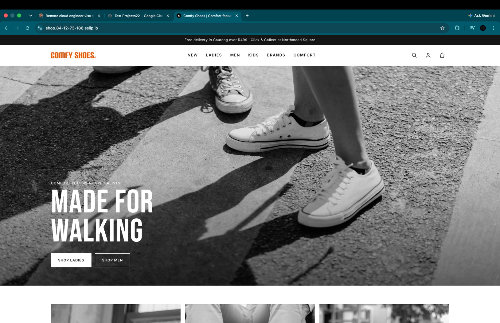

# Comfy Shoes — headless commerce synced with ERPNext

A production e-commerce platform for **Comfy Shoes**, a comfort-footwear retailer with a physical store at Northmead Square, Benoni. The online store and the shop's till share one stock and accounting system, so a pair sold in-store disappears online within seconds, and every web order lands in the ERP as proper accounting documents.

Built and operated by [Ntsika Gqiba](https://www.linkedin.com/in/ntsika-gqiba) at LNS Corporation. Published with the company's permission. **This repo documents architecture and decisions only; source code, credentials and customer data are not included.**

---

## The problem

The store's stock and accounts lived in ERPNext (the till and stock master). The old WooCommerce site had no reliable link to it, so online stock drifted from the shelf, overselling was a constant risk, and web orders were re-keyed by hand.

**The goal:** a fast, mobile-first store where ERPNext stays the single source of truth for stock, prices and accounts, at near-zero running cost.

## Architecture

```mermaid
flowchart LR
  subgraph Store["Northmead Square store"]
    TILL[ERPNext v16<br/>till · stock · accounts]
  end
  subgraph OCI["Oracle Cloud (Arm, Always Free)"]
    CADDY[Caddy<br/>TLS + reverse proxy]
    SF[Next.js storefront]
    MED[Medusa 2 server + worker]
    PG[(Postgres)]
    RD[(Redis)]
  end
  CF[Cloudflare<br/>DNS · CDN · TLS] --> CADDY
  CADDY --> SF --> MED
  MED --- PG
  MED --- RD
  TILL -- "signed webhooks<br/>stock · price" --> MED
  MED -- "outbox worker<br/>orders · payments · returns" --> TILL
  MED -- "15-min reconciliation" --> TILL
  MED --> PAY[Paystack]
  MED --> SHIP[The Courier Guy]
  MED --> MAIL[Resend · Klaviyo]
```

| Layer | Choice |
|---|---|
| Storefront | Next.js (from Medusa's DTC starter), custom "Monochrome Editorial" design system |
| Commerce engine | Medusa 2.x (TypeScript), pnpm + Turborepo monorepo |
| ERP | ERPNext v16 with a custom Frappe app (`comfy_sync`, Python) |
| Data | Postgres, Redis |
| Payments / shipping | Paystack, The Courier Guy, Click & Collect |
| Email / marketing | Resend (transactional), Klaviyo (flows) |
| Hosting | Oracle Cloud Ampere A1 VMs, Docker Compose, Caddy, Cloudflare in front |
| Quality | Playwright end-to-end journey, axe accessibility checks, Lighthouse CI budgets, GitHub Actions |
| Monitoring | Sentry, uptime checks, built-in sync health alerts |

## How the sync works

### Stock and prices: ERPNext → Medusa (push + reconcile)

- A Frappe hook fires on every **Stock Ledger Entry** submit (cancels included, since ERPNext posts reversing entries). It sends an **HMAC-SHA256 signed webhook** after the database commit, retrying up to 3 times with backoff.
- Medusa verifies the signature and a **±300 s timestamp window**. It then **deduplicates on event ID**, **drops stale events** using the ERPNext bin's modified time, and takes a **per-SKU lock** before applying.
- Sellable stock is computed, not copied:
  `S = max(0, A − F − B)`.
  Here *A* is ERPNext's on-hand quantity, *F* is units on web fulfilments the ERP hasn't seen yet, and *B* is a safety buffer of 1 when stock is 2 or fewer. This prevents overselling the last pair.
- Event IDs are recorded only **after** a successful apply, so a failed apply is retried rather than discarded as a duplicate.
- A **reconciliation job every 15 minutes** pages through all ERPNext bins, repairs drift, records the drift %, and alerts above 2%.
- Price webhooks are treated as *triggers only*. Medusa re-reads the price from ERPNext. If no price exists, the web price is removed so nothing can sell at a stale price.

### Orders, payments and returns: Medusa → ERPNext (transactional outbox)

Every commerce event writes a row to an `erp_sync_outbox` table with a **unique idempotency key** (`{kind}:{aggregate_id}`), so redelivered events never create duplicates.

| Event | Result in ERPNext |
|---|---|
| Order placed | Customer upserted, submitted VAT-inclusive Sales Order |
| Fulfilment created | Delivery Note for the fulfilled lines |
| Payment captured | Sales Invoice + Payment Entry (Paystack reference) |
| Refund | Credit note + Payment Entry, VAT reversed proportionally |
| Return received | Return Delivery Note. Good stock goes back to the store; damaged stock goes to a separate warehouse outside the sync |
| Order cancelled | Sales Order cancelled |

- A worker processes the outbox every minute under a single-flight lock.
- **Retryable** failures (429, 5xx, network, "not ready yet") back off exponentially, capped at 60 minutes. Non-retryable errors go straight to a **dead-letter** state. After 10 attempts a row is dead-lettered.
- Every handler **looks up before it creates** and re-checks after a unique-constraint conflict, so concurrent retries are safe.
- Returns are **incremental**: each step posts only what hasn't been posted yet, per SKU and warehouse. Re-runs never double-return stock.
- Staff get an **ERP sync admin page** with health badges, dead-letter and waiting lists, and one-click retry. Alerts fire on backlog > 50, any dead row, drift > 2%, or no reconciliation for 45 minutes.

## Infrastructure & cost

- **Production and staging on Oracle Cloud's Always Free tier**, on separate Arm VMs (2 OCPU / 12 GB each), so a staging deploy can never touch production. **Running cost: R0/month**, with a budget alert at R1.
- The tenancy was upgraded to pay-as-you-go to remove the idle-reclamation risk that applies to free-only accounts.
- **Cloudflare** handles DNS, TLS and edge caching, and absorbs ad-traffic spikes. Oracle has no Johannesburg region, so caching covers the latency gap. The origin is locked to Cloudflare.
- **Backups we own:**
  - Nightly `pg_dump` kept 7 days on the VM.
  - Copies off-box to OCI Object Storage and to a second, non-Oracle provider.
  - Weekly boot-volume backups.
  - A restore test before launch and monthly after.
- **Accepted trade-off:** a single VM is a single point of failure, with a restore target under 1 hour via the runbook. The till keeps selling regardless, because ERPNext is separate.
- **Exit path:** everything is containerised. Moving to Cloud Run + Cloud SQL or AWS is estimated at about a day of work when traffic justifies it.

## Quality gates

- **Playwright journey** on a mobile profile: browse → filter by in-stock size → product page (checks Product JSON-LD) → bag → checkout → Paystack test payment → confirmation. It then **polls ERPNext to confirm the Sales Order arrived**. It refuses to run against the live ERP.
- **Accessibility:** axe WCAG 2.0/2.1 A + AA on 14 key pages. The suite fails on serious issues, not just critical ones.
- **Lighthouse CI budgets** (mobile, slow 4G): LCP < 2.5 s, CLS < 0.1, TBT < 200 ms, JS < 170 kB, accessibility ≥ 0.95.
- **These gates caught a real launch blocker:** the legacy-URL redirect map sent `/checkout` to `/cart`, so nobody could check out. The redirect builder now protects live routes, with a unit test.

## Decisions on record

The project has **18 Architecture Decision Records**, including:

| ADR | Decision |
|---|---|
| 001 | Inventory math: buffer, in-flight fulfilments, stale-event rules |
| 003 | VAT-inclusive orders end to end |
| 004 | Flat ERPNext items, with colourways derived from item codes |
| 005 / 016 | Staging and production on Oracle Always Free |
| 006 / 007 | Paystack payments, The Courier Guy shipping |
| 014 | Speed & SEO, with on-demand revalidation when stock or price changes |
| 015 | End-to-end tests, accessibility and performance budgets |
| 017 / 018 | Transactional email; Klaviyo flows and Google review requests |

## Status

- **Live** on a temporary domain.
- **Cutover to comfyshoes.co.za** is in progress, following a written cutover checklist.

## What I'd do next

- Infrastructure as Code (Terraform for the OCI VMs, networking and buckets) instead of console setup.
- Move CI's staging checks to run on every pull request, not just `main`.
- Field performance data (real-user INP/LCP) to complement the lab budgets.

---

*Questions about the architecture? [Get in touch on LinkedIn](https://www.linkedin.com/in/ntsika-gqiba).*
